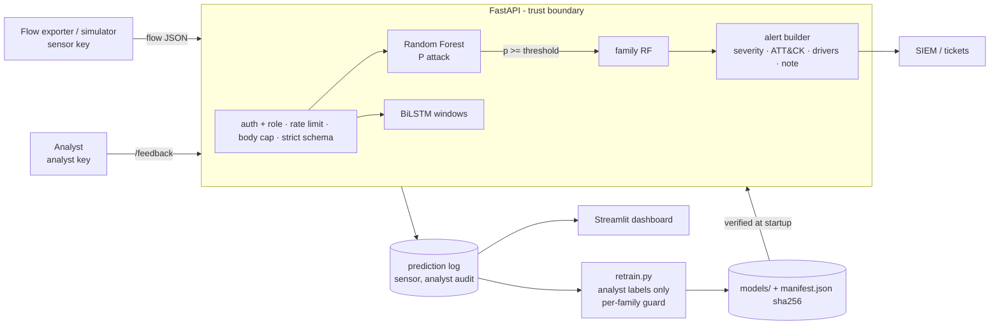

# ML Intrusion Detection, attacked from both sides

An end-to-end network intrusion detector on **UNSW-NB15**: Random Forest
and BiLSTM models behind a hardened FastAPI service that emits
SOC-ready alerts (severity, MITRE ATT&CK mapping, the features that
drove the verdict, a triage note).

The model is only half the project. The other half treats the detector
as a target: it **audits its own evaluation for leakage**, then
**poisons** it, **evades** it and **hardens** it, and backs every claim
with a script or a test.

> **TL;DR for reviewers**
> * The v1 headline (RF macro-F1 **0.948**, LSTM AUC **0.998**) came from a
>   leaky random re-split: 40% of UNSW-NB15 rows are exact duplicates,
>   and the LSTM's overlapping windows sat in train *and* test. Under a
>   leakage-free protocol, the same pipeline and hyperparameters score **macro-F1 0.818
>   [0.815, 0.822]** with a **26.5%** false-positive rate at 0.5.
> * An unauthenticated `Label` field in v1's `/predict` was a training-data
>   poisoning path. **1,764 poisoned rows (2% of train) cut Backdoor recall
>   from 1.00 to 0.67 while overall accuracy went *up*.** The v1 retrain guard
>   accepted that model. The fixed pipeline refuses it.
> * Evasion: an attacker who only picks their **initial TTL** evaded the
>   plainly trained Random Forest **100%** of the time, and padding or
>   slowing down evaded it 21–60% of the time. The **served model is now
>   hardened** (no TTL features + adversarial training): **≤ 3.3%** evasion
>   at every budget tested, for 0.005 macro-F1. It is robust to *this*
>   perturbation family only.
> * 108 tests, CI with `bandit` + `pip-audit`, a threat model mapped to
>   STRIDE / MITRE ATLAS / OWASP API Top 10.

## Contents

1. [Results: what the model really does](#1-results-what-the-model-really-does)
2. [Security angle: the IDS as an attack surface](#2-security-angle-the-ids-as-an-attack-surface)
3. [What an alert looks like](#3-what-an-alert-looks-like)
4. [Architecture](#4-architecture)
5. [2-minute demo](#5-2-minute-demo)
6. [Reproduce everything](#6-reproduce-everything)
7. [Limitations](#7-limitations)
8. [Debugging timeline](#8-debugging-timeline)
9. [Project structure](#9-project-structure)

## 1. Results: what the model really does

### One model, five evaluation protocols

Same Random Forest, same hyperparameters, only the split changes
(`src/evaluation/rigorous_eval.py` → [`reports/rigorous_eval.md`](reports/rigorous_eval.md)):

| protocol | what it means | test rows | macro-F1 (95% CI) | ROC-AUC | FPR @0.5 |
|---|---|---:|---|---:|---:|
| `random_resplit` | v1: combined table, random 70/15/15 | 38,651 | 0.948 [0.945, 0.950] | 0.992 | 5.3% |
| `random_resplit_dedup` | ... after dropping exact duplicates | 23,115 | 0.917 [0.914, 0.922] | 0.981 | 7.6% |
| `official` | official train file → official test file | 82,332 | 0.862 [0.860, 0.865] | 0.981 | 27.5% |
| **`official_novel`** | **official split, test = flows never seen in training** | **52,648** | **0.818 [0.815, 0.822]** | **0.963** | **26.5%** |
| `official_novel_no_ttl` | ... without the TTL testbed-artifact features | 52,648 | 0.816 [0.813, 0.819] | 0.961 | 26.8% |
| **`official_novel_hardened`** | **the served recipe: no TTL + adversarial training** | **52,648** | **0.813 [0.810, 0.817]** | **0.960** | **27.5%** |

`official_novel` is the protocol the service ships with
(`src/data/splits.py`; `tests/test_rigor.py` proves no test flow has a
twin in training). The served model is the hardened recipe in the last
row: it gives up 0.005 F1 against the plain model in exchange for the
evasion robustness in §2.

Three things this table teaches:

* **Duplicates and the split, not the model, explained ~13 F1 points.**
  The two capture periods differ, so FPR jumps 5× once the test set
  comes from the other capture.
* **Importance is not necessity.** `sttl` / `ct_state_ttl` are the top two
  features (TTL is a known UNSW-NB15 testbed artifact), yet removing all
  TTL features costs only 0.002 F1, because other features carry the same
  class separation. Keeping them is not free, though: they make the
  model trivially evadable (§2, attack 2).
* **Thresholds don't transfer across captures.** A threshold set on
  validation for FPR ≤ 1% gives **4–5% FPR** on test.

### What that means for a SOC

Hardened recipe at its validation-chosen threshold (0.880): TPR 0.765,
FPR 0.043. At 1M flows/day:

| attack prevalence | alert precision | true alerts/day | false alerts/day |
|---:|---:|---:|---:|
| 1% | 15.2% | 7,654 | 42,551 |
| 0.1% | 1.8% | 765 | 42,938 |

(The served artifact, fitted separately by `random_forest.py`, lands at
threshold 0.870 with TPR 0.778 / FPR 0.050, within about a point; the
difference comes from fitting on CSV round-tripped versus in-memory floats.)

That's the base-rate fallacy in numbers: a model with 0.96 AUC still
produces ~43k false alerts a day. This is why the service emits
*explained*, severity-ranked alerts for human triage and never
auto-blocks (see [`docs/limitations.md`](docs/limitations.md) §6).

### Per-family recall (hardened recipe at its operating threshold)

| Generic | Recon | Worms | Exploits | Backdoor | DoS | Shellcode | Analysis | **Fuzzers** |
|---:|---:|---:|---:|---:|---:|---:|---:|---:|
| 0.964 | 0.942 | 0.930 | 0.916 | 0.886 | 0.886 | 0.882 | 0.789 | **0.226** |

Fuzzers are built to look like benign traffic, and per-flow statistics
can't see them. This weak spot survived every fix (§8).

### Sequence model (BiLSTM, windows of 10 flows)

| split | windows shared with training | accuracy | F1 | AUC |
|---|---|---:|---:|---:|
| v1 random window split | 54,041 flows | 0.981 | 0.985 | 0.998 |
| **official, built per file + temporal val cut** | **0** | **0.869** | **0.894** | **0.989** |

Same code and hyperparameters: `src/models/lstm_model.py --split-mode random|official`.
The v1 random split put 54,041 flows into both training and test windows
(stride 5 < window 10). On the 10,544 flows both models score, the
honest LSTM and the served RF are **statistically tied**: accuracy 0.819
vs 0.815, McNemar p = 0.27 (0.819 vs 0.818, p = 0.84 against the plain RF) ([`reports/model_comparison.md`](reports/model_comparison.md)).
v1's "LSTM is stronger" came from the leak. With the cleaned dataset's
weak grouping key (no IPs), there is little sequence signal to learn.

### Attack-family classifier

A separate multi-class RF (attack rows only) picks the ATT&CK mapping
for an alert: accuracy 0.81, macro-F1 0.63
([`reports/family_classifier.json`](reports/family_classifier.json)).
It does well on Generic, Fuzzers, Recon and Exploits (F1 ≥ 0.82) and
routinely confuses DoS, Analysis, Backdoor and Shellcode (F1 0.22–0.49),
which share flow statistics in UNSW-NB15. Alerts therefore show the
family *probability* and a mapping-fidelity rating, never a bare label.
(v1 reported `P(attack) × fixed priors`, which gave every flow the same
family ranking.)

## 2. Security angle: the IDS as an attack surface

Full threat model with STRIDE / ATLAS / OWASP mapping and evidence per
row: [`docs/threat_model.md`](docs/threat_model.md).

### Attack 1: label poisoning (MITRE ATLAS AML.T0020)

v1's `/predict` accepted `Label` / `attack_cat` from any caller, logged
them as ground truth, and `retrain.py` trained on them.
`src/attacks/poisoning.py` replays Backdoor flows labelled benign into a
retrain that also contains genuine new data
([`reports/poisoning.md`](reports/poisoning.md)):

| poison rows (% of train) | accuracy | Backdoor recall | v1 guard (aggregate) | v2 guard (+ per-family) |
|---:|---:|---:|---|---|
| 0 | 0.8208 | 1.000 | accept | accept |
| 441 (0.5%) | 0.8203 | 0.957 | **accept** | refuse |
| 1,764 (2%) | 0.8210 | 0.671 | **accept** | refuse |
| 4,411 (5%) | 0.8181 | 0.614 | **accept** | refuse |

Fixes, each tested:
* **No labels on the scoring path**: the sensor schema is `extra="forbid"`,
  so a `Label` field gets a 422.
* **Labels only via `/feedback`**: requires an `analyst` key, is tied to a
  logged `prediction_id`, and records `labeled_by` / `sensor` for audit.
* **Retrain trusts only analyst labels**. Pseudo-labelling is opt-in,
  because self-training on "confidently benign" evasions teaches the
  model they're benign.
* **Guard refuses any per-family recall drop greater than 0.02**, since
  targeted poisoning hides inside aggregate accuracy.

### Attack 2: evasion (ATLAS AML.T0015 / AML.T0043)

`src/attacks/evasion.py` assumes a black-box attacker who controls only
their own side of the flow and can only *add* cost: pad payloads, add
packets, slow down, pick an initial TTL. Derived fields are recomputed
so records stay self-consistent. It runs a random search (40
queries/flow, budget ε = max relative increase) against
correctly-detected test attacks ([`reports/evasion.md`](reports/evasion.md)):

| model | clean TPR / FPR | ε = 0 + TTL | ε = 0.25 | ε = 1 | ε = 4 | ε = 1 + TTL |
|---|---|---:|---:|---:|---:|---:|
| plain RF (v1 recipe, `--baseline`) | 0.787 / 0.050 | **100%** | 20.5% | 38.1% | 59.6% | **100%** |
| RF without TTL features | 0.779 / 0.048 | 0% | 23.3% | 46.2% | 67.7% | 46.2% |
| **served: no-TTL + adversarial training** | **0.778 / 0.050** | **0%** | **3.3%** | **2.3%** | **1.1%** | **1.9%** |

(ε = 0 without TTL gives 0% for every model, a sanity check that the
perturbation code is an exact identity at zero budget.)

* **One attacker-controlled byte defeated the plainly trained model.** In the
  UNSW testbed, observed `sttl` = 31 is benign in 100% of rows. Setting
  the initial TTL to land there flips every detected attack to "benign".
  The rigorous eval showed that dropping TTL costs almost nothing in accuracy (0.002 F1),
  and this shows it is *required* for robustness: importance analysis
  alone would never have flagged it.
* **Without TTL, cheap padding and slowing still evade 23–68% of
  detections.** Fuzzers and Analysis, already the weakest families, are
  the easiest to push over.
* **Adversarial training** (perturbed training attacks added as attacks,
  `src/models/hardening.py`) cuts evasion to ≤ 3.3% for about 0.005 F1,
  so this is the model the API serves.
  `tests/test_serving.py::test_hardened_model_verdict_ignores_ttl` checks
  that changing `sttl` cannot move its score. The caveat matters: it is robust to
  the perturbation family it was trained on. An adaptive attacker with
  other knobs (protocol choice, splitting one attack across many flows)
  is out of scope and listed as residual risk.

### Hardening the service (OWASP API Security Top 10)

| control | OWASP API | test |
|---|---|---|
| API keys with `sensor` / `analyst` roles. Server stores only SHA-256 digests, compares in constant time, and fails closed when no keys are configured | API2, API5 | `test_predict_requires_valid_key`, `test_fails_closed_without_configured_keys`, `test_sensor_cannot_submit_labels` |
| Strict schema: unknown fields rejected, NaN/inf rejected, every numeric field bounded, token patterns on strings | API3, API8 | `test_invalid_records_are_rejected`, `test_nan_and_infinity_are_rejected` |
| Per-key token bucket (429 + `Retry-After`), streamed body cap (413), ≤ 512 flows per sequence | API4 | `test_rate_limit_returns_429_with_retry_after`, `test_oversized_body_is_rejected`, `test_sequence_length_is_capped` |
| SHA-256 pinning of every artifact *and the alert threshold* in `models/manifest.json`. Pickles load from the exact bytes that were hashed (no TOCTOU), and the API refuses to start on mismatch (`joblib.load` would otherwise run attacker code; a threshold of 1.0 would blind the IDS) | API8, supply chain | `test_tampered_model_refuses_to_load`, `test_tampered_threshold_refuses_to_load`, `test_swap_after_verification_is_not_loaded` |
| No stack traces, no echoed input in 422 bodies (echoing NaN crashed the default handler with a 500), `/health` exposes liveness only, docs off by default, `nosniff` / `no-store` / `DENY` headers | API8 | `test_health_is_public_and_discloses_nothing` |
| CI: `bandit -ll` on `src/`, `pip-audit --strict` on the pinned `requirements.lock` | supply chain | `.github/workflows/ci.yml` |

## 3. What an alert looks like

A held-out Reconnaissance flow sent to `/predict` (real output, trimmed
to three drivers):

```json
{
  "prediction_id": 1, "prediction": 1, "p_attack": 0.960,
  "threshold": 0.870, "model_version": "f7cbf7ffa599",
  "alert": {
    "event":  {"kind": "alert", "severity": "high", "risk_score": 96.0,
               "reference": "prediction:1"},
    "threat": {"framework": "MITRE ATT&CK", "tactic": "Reconnaissance / Discovery",
               "technique": [{"id": "T1595", "name": "Active Scanning"},
                             {"id": "T1046", "name": "Network Service Discovery"}],
               "mapping_fidelity": "high"},
    "ml": {"model": "random_forest_hardened",
           "family": "Reconnaissance", "family_probability": 0.973,
           "drivers": [
             {"feature": "ct_srv_dst",     "value": 1,  "contribution": 0.067},
             {"feature": "ct_dst_src_ltm", "value": 1,  "contribution": 0.052},
             {"feature": "ct_srv_src",     "value": 13, "contribution": -0.040}],
           "artifact_driven": false},
    "triage_note": "[HIGH] Random Forest flagged flow tcp/- state=FIN as malicious (P(attack)=0.96).\nMost likely family: Reconnaissance (p=0.97) -> T1595 Active Scanning, T1046 Network Service Discovery [mapping fidelity: high].\nMain drivers: ct_srv_dst=1 (+0.067); ct_dst_src_ltm=1 (+0.052); ct_srv_src=13 (-0.040).\nNext: Pivot on the source: count distinct dst ports/hosts in the last 15 min.\nNext: Check whether the scan is followed by Exploits from the same source."
  }
}
```

Fields follow the Elastic Common Schema (`event.*`, `threat.*`), so the
alert can ship to a SIEM as is. The drivers are *exact*: the
Random-Forest decision-path contributions sum to the predicted
probability (`tests/test_soc.py::test_contributions_reconstruct_predict_proba_exactly`),
with no SHAP approximation. The served model never sees TTL. For models that do (`--baseline`), the
note warns when TTL features carry most of the score, because that
verdict rests on a testbed artifact. ATT&CK
mappings carry a fidelity rating, and `Generic` is deliberately left
unmapped rather than forced into a technique
([`src/soc/attack_mapping.py`](src/soc/attack_mapping.py)).

## 4. Architecture



## 5. 2-minute demo

Linux / macOS, Python 3.12–3.13 (TensorFlow has no 3.14 wheels yet).

```bash
python3.13 -m venv .venv && .venv/bin/pip install -r requirements.lock
```

```bash
scripts/reproduce.sh
```

```bash
scripts/demo.sh
```

`demo.sh` generates a sensor key and an analyst key, starts the API,
streams 40 held-out flows as the sensor (the analyst role confirms each
verdict through `/feedback`), prints one triage note, then shows the
controls refusing an unauthenticated call (401), a `Label` in the
scoring payload (422), a sensor calling `/feedback` (403) and an
out-of-range TTL (422). For the live dashboard, run `streamlit run
src/dashboard/app.py` against the same log.

## 6. Reproduce everything

`scripts/reproduce.sh` runs the whole pipeline in order (~15 min on 8
CPU cores, seeded). The dataset is the cleaned UNSW-NB15 CSVs from the
HuggingFace mirror (~45 MB), fetched by `src/data/download_dataset.py`.
`data/`, `models/` and the logs are gitignored. Every report in
`reports/` is regenerated by a named script:

| report | script |
|---|---|
| `rigorous_eval.md` | `src/evaluation/rigorous_eval.py` |
| `poisoning.md` | `src/attacks/poisoning.py` |
| `evasion.md` | `src/attacks/evasion.py` |
| `model_comparison.md`, confusion matrices | `src/evaluation/evaluate.py` |
| `family_classifier.json` | `src/models/family_classifier.py` |
| `lstm_results*.json` | `src/models/lstm_model.py` |

Tests: `python -m pytest tests -q`. **108 tests**. The API and security
tests run against synthetic artifacts built in `tests/conftest.py`, so
CI exercises the service without the dataset.

## 7. Limitations

Detailed in [`docs/limitations.md`](docs/limitations.md). The short version:

* UNSW-NB15 is a 2015 synthetic testbed, and the cleaned variant has no
  IPs or timestamps. The LSTM therefore groups by `(proto, service)` in
  file order, which gives a weak sequence signal.
* **Not run: a cross-dataset check** (e.g. CIC-IDS2017). Its CICFlowMeter
  features barely overlap UNSW's Argus features, so a "generalisation"
  number would mostly measure feature mapping. The official-split shift
  above is the honest proxy for now.
* **Not run: pcap → alert.** The models need Argus features (`ct_*`,
  `sttl`, ...). A Python re-implementation would be a different feature
  space, so the demo replays held-out flows instead.
* Thresholds were chosen on the training capture and do not transfer
  (5% vs 1% FPR). Recalibrate on the defended network.
* API: no TLS (terminate at a proxy), keys come from an env var (use a
  secret manager), and an attacker who can rewrite both an artifact and
  the manifest defeats pinning (sign the manifest). See the threat
  model's residuals.

## 8. Debugging timeline

Bugs found and fixed, each with a regression test. Each is a silent
failure mode of ML systems.

1. **Label leakage into features.** `attack_cat` sat beside the `Label`
   target. Both are now dropped from `X`, and `src/data/leakage_check.py`
   scans for features that correlate ~1.0 with the label.
2. **NaN/None dtype mismatch in retrain dedup.** Replayed test flows could
   survive deduplication and leak into retraining
   (`tests/test_retrain.py`).
3. **RF/pipeline desync.** The deployed RF had been trained on an older
   `X_train.csv`. That is now prevented by the artifact manifest
   (`docs/limitations.md` §3).
4. **JSON nulls misrouted** to the categorical branch in the serving
   transform. `tests/test_rigor.py` now checks that the serving and
   training transforms agree.
5. **Leaky evaluation** (this overhaul): duplicates across a random
   split, and overlapping LSTM windows on both sides. Fixed by
   `src/data/splits.py` and `--split-mode official`. See §1.
6. **Unauthenticated label path = training-data poisoning.** See §2.
7. **`confidence = max(p, 1-p)` used as a severity input.** A confidently
   benign flow would have paged someone. Severity now keys off
   `p_attack` (`tests/test_soc.py`).
8. **The 422 handler crashed on NaN.** Pydantic rejected the value, then
   echoing it back broke JSON serialisation and returned a 500.
9. **`.gitignore` `models/` also matched `src/models/`.** New model code
   was silently left out of commits. The pattern is now anchored to the
   repo root.
10. **`extract.py`**: throughput was never computed, and the
    packet-size fallback ignored the canonical `Spkts` spelling.

## 9. Project structure

```
src/
  data/        download_dataset.py, splits.py (leakage-aware protocols), leakage_check.py, explore.py
  features/    preprocess.py (impute/encode/scale/SMOTE), extract.py
  models/      random_forest.py, lstm_model.py, family_classifier.py, retrain.py, manifest.py
  evaluation/  rigorous_eval.py, metrics.py (base rates, CIs), evaluate.py, per_class_metrics.py
  attacks/     poisoning.py, evasion.py
  soc/         alerts.py, explain.py (exact path contributions), attack_mapping.py
  serving/     api.py, security.py, prediction_log.py, simulate_traffic.py
  dashboard/   app.py (Streamlit)
docs/          threat_model.md, limitations.md
scripts/       reproduce.sh, demo.sh
tests/         108 tests (synthetic artifacts in conftest.py)
reports/       every number in this README, regenerated by the scripts above
```

## Citation

Dataset: N. Moustafa and J. Slay, "UNSW-NB15: A comprehensive data set
for network intrusion detection systems," MilCIS 2015.

## Author

Built by **Guerfi Ahmed Yacine**, a cyber security engineering student at ESI Sidi Bel Abbès. Portfolio: [n4khla.github.io](https://n4khla.github.io) · [LinkedIn](https://www.linkedin.com/in/guerfi-ahmed-yacine-6831b32b8/)
