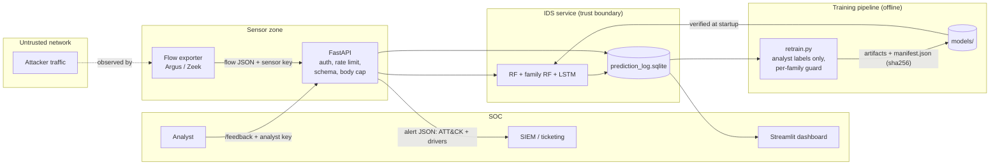

# Threat model: the IDS as an attack surface

An ML intrusion detector is itself a target. An attacker who can blind it,
flood it or swap its model doesn't need to be stealthy anywhere else. This
document lists what this system defends, who attacks it, how each attack
maps to STRIDE / MITRE ATLAS / OWASP API Top 10, and **which control or
test backs each claim**. Status is one of: *mitigated* (control + test),
*measured* (attack quantified, partial mitigation) or *residual*
(documented, not fixed).

## System and trust boundaries

**Assets:** detection capability (recall per family), model and pipeline
artifacts, the training data / label stream, availability of the scoring
API, analyst attention (false-positive budget).

**Adversaries:**

| actor | capability | goal |
|---|---|---|
| A1 external attacker | shapes their own traffic; observes whether they get blocked (black-box oracle) | evade detection |
| A2 attacker with network reach to the API | sends arbitrary HTTP to the service | poison, DoS, probe the model |
| A3 insider / compromised CI or storage | writes files in `models/` or the log DB | backdoor or replace the model |

## Threats, controls and evidence

| # | threat | STRIDE | ATLAS / OWASP API | control | evidence | status |
|---|---|---|---|---|---|---|
| T1 | **Label poisoning through the scoring API.** v1 accepted `Label` in `/predict`, logged it as ground truth and `retrain.py` trained on it: anyone could relabel their attack flows benign | Tampering | AML.T0020 Poison Training Data; API1/API3 | sensor payload is `extra="forbid"` (labels → 422); labels only via `/feedback` with an analyst key, tied to a logged prediction id, audited (`labeled_by`, `sensor`); retrain ignores labels whose `label_source != analyst` | `tests/test_serving.py::test_labels_in_scoring_payload_are_rejected`, `::test_analyst_feedback_is_the_only_label_path_and_is_audited`, `tests/test_retrain.py::test_apply_labels_ignores_labels_not_from_an_analyst`; impact quantified in `reports/poisoning.md` | mitigated |
| T2 | **Targeted poisoning that passes the retrain guard.** Aggregate accuracy barely moves when one small family is blinded | Tampering | AML.T0020, AML.T0018 Backdoor ML Model | guard also refuses any per-family recall drop > 0.02 | `tests/test_retrain.py::test_guard_refuses_targeted_family_regression`; `reports/poisoning.md` (v1 vs v2 guard verdicts) | mitigated (for families present in the test set) |
| T3 | **Self-training amplifies evasion.** Pseudo-labelling high-confidence "benign" verdicts teaches the model that an evasive flow is benign | Tampering | AML.T0020 | pseudo-labels are off by default (`--pseudo-labels` opt-in) | `src/models/retrain.py` docstring and flag | mitigated (by default) |
| T4 | **Feature-space evasion.** Attacker pads bytes, adds packets, slows down, sets initial TTL | Spoofing (of benign behaviour) | AML.T0015 Evade ML Model, AML.T0043 Craft Adversarial Data | TTL features removed in the hardened variant; adversarial training | `reports/evasion.md`; `tests/test_attacks.py` (perturbations respect the threat model) | measured; residual risk documented |
| T5 | **Model / pipeline swap → code execution.** `joblib.load` unpickles; a replaced file runs code in the API process. Also the v1 RF/pipeline desync | Tampering, Elevation | AML.T0010 ML Supply Chain Compromise; API8 | every artifact pinned by SHA-256 in `models/manifest.json`, written by each training step; API refuses to start on mismatch | `tests/test_serving.py::test_tampered_model_refuses_to_load` | mitigated against file swap; **residual** if the attacker can rewrite the manifest too (sign it, e.g. cosign) |
| T6 | **Unauthenticated access** | Spoofing | API2 Broken Authentication | API keys (SHA-256 digests server-side, constant-time compare), fail closed with no keys | `::test_predict_requires_valid_key`, `::test_fails_closed_without_configured_keys` | mitigated |
| T7 | **Sensor submits analyst verdicts** | Elevation | API5 Broken Function Level Authorization | role check: `/feedback` requires `analyst` | `::test_sensor_cannot_submit_labels` | mitigated |
| T8 | **Resource exhaustion** (huge sequences on the LSTM, floods, oversized bodies) | DoS | AML.T0029 Denial of ML Service; API4 Unrestricted Resource Consumption | `flows` ≤ 512, streamed body cap (413), per-key token bucket (429 + Retry-After) | `::test_sequence_length_is_capped`, `::test_oversized_body_is_rejected`, `::test_rate_limit_returns_429_with_retry_after` | mitigated (per key; a distributed flood needs an upstream proxy) |
| T9 | **Log poisoning / injection** via arbitrary extra JSON stored in sqlite and re-read by retrain/dashboard | Tampering | API3 / API8 | strict schema, bounded numerics, token patterns, NaN/inf rejected; parameterised SQL only | `::test_invalid_records_are_rejected`, `::test_nan_and_infinity_are_rejected`; bandit clean in CI | mitigated |
| T10 | **Information disclosure** (stack traces, model paths, input reflection) | Info disclosure | API8 Security Misconfiguration | generic 500 handler, 422 without echoed input (echoing NaN used to crash the handler), `/health` shows liveness only, OpenAPI docs off by default, `nosniff` / `no-store` / `DENY` headers | `::test_health_is_public_and_discloses_nothing` | mitigated |
| T11 | **Model extraction / oracle abuse.** The verdict (and alert drivers) help an attacker map the boundary | Info disclosure | AML.T0024 Exfiltration via ML Inference API, AML.T0040 | rate limiting, keys per sensor; drivers only on alerts | – | residual: the alert explains *why*, which is what an analyst needs and also what an attacker wants. Keep alert JSON inside the SOC |
| T12 | **Repudiation of labels** | Repudiation | – | `labeled_by`, `labeled_at`, `sensor` columns | `::test_analyst_feedback_is_the_only_label_path_and_is_audited` | mitigated |
| T13 | **Vulnerable dependencies** | – | API8 / supply chain | `requirements.lock` pinned; `pip-audit --strict` and `bandit` in CI | `.github/workflows/ci.yml` | mitigated at build time; GitHub Actions pinned by tag, not SHA (residual) |

## Out of scope / known residuals

* **Transport security.** The service speaks plain HTTP; terminate TLS at
  a reverse proxy (and use mTLS for sensors if possible).
* **Secrets handling.** Key digests come from an env var; use a secret
  manager and rotate keys. Keys are bearer tokens: anyone with one can
  act as that sensor.
* **Distributed floods** beyond per-key limits belong to an upstream
  proxy / WAF.
* **The detector's own blind spots** (Fuzzers, Analysis, distribution
  shift from the 2015 testbed): see `docs/limitations.md` and
  `reports/rigorous_eval.md`. No API control fixes a model that can't
  see an attack.
