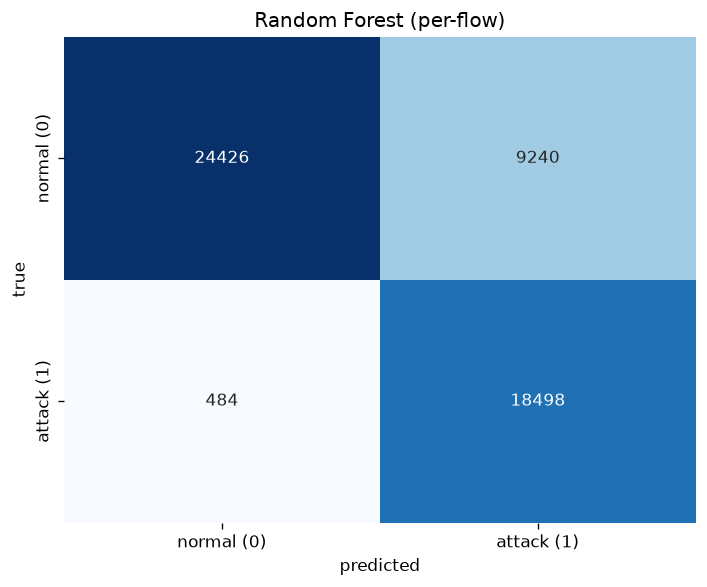
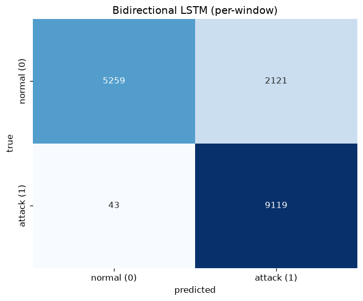

# Model Comparison: Random Forest vs Bidirectional LSTM

> Generated by `src/evaluation/evaluate.py`. Split protocol:
> `official_novel`
> (RF flows and LSTM windows both come from the official testing file;
> see `reports/rigorous_eval.md` for why the protocol matters). Both
> models are scored at threshold 0.5 here.

## Unit convention (read first)

| Model | Evaluation unit | Test set |
|---|---|---|
| Random Forest | **per-flow** (one flow = one prediction) | `data/processed/X_test.csv` |
| LSTM | **per-window** (up to 10 flows = one prediction) | `data/processed/lstm_test.npz` |

The two test sets are **not directly comparable**: a window prediction
covers several flows and is labelled "attack" if any flow in the window
is an attack. Treat the table below as separate model reports, and the
"Aligned comparison" section as the only statistically valid head-to-head.

## Overall metrics

| Metric | RF (per-flow) | LSTM (per-window) |
|---|---|---|
| accuracy | 0.8153 | 0.8692 |
| precision (macro) | 0.8237 | 0.9016 |
| recall (macro) | 0.8500 | 0.8540 |
| F1 (macro) | 0.8129 | 0.8616 |
| F1 (weighted) | 0.8188 | 0.8651 |
| ROC-AUC | 0.9600 | 0.9892 |
| samples | 52,648 flows | 16,542 windows |
| inference speed | 369,430 samples/s | 6,332 samples/s |

## Per-class F1

| Class | RF | LSTM |
|---|---|---|
| normal (0) | 0.8340 | 0.8294 |
| attack (1) | 0.7919 | 0.8939 |

## Confusion matrices

## Random Forest: per-attack-family F1 (one-vs-rest)

Each family is the "positive" class in truth; "positive" for the model
is *any* attack alarm. Recall = share of the family caught; precision =
share of attack alarms belonging to that family.

| family         |   support |   precision |   recall |     f1 |
|:---------------|----------:|------------:|---------:|-------:|
| Exploits       |      7085 |      0.2541 |   0.9949 | 0.4048 |
| Fuzzers        |      4335 |      0.1407 |   0.9003 | 0.2434 |
| Generic        |      3381 |      0.1218 |   0.9994 | 0.2172 |
| Reconnaissance |      2224 |      0.0801 |   0.9996 | 0.1484 |
| DoS            |      1186 |      0.0427 |   0.9992 | 0.0819 |
| Shellcode      |       364 |      0.0130 |   0.9918 | 0.0257 |
| Analysis       |       294 |      0.0103 |   0.9694 | 0.0203 |
| Backdoor       |        70 |      0.0025 |   1.0000 | 0.0050 |
| Worms          |        43 |      0.0016 |   1.0000 | 0.0031 |
| Normal         |         0 |      0.0000 |   0.0000 | 0.0000 |

## Aligned comparison (McNemar)

Both models are evaluated on the same flows: the **last flow of each LSTM
test window** that also belongs to the RF flow-test split.

| statistic | value |
|---|---|
| aligned pairs | 10,544 |
| RF accuracy / F1 | 0.8147 / 0.7915 |
| LSTM accuracy / F1 | 0.8188 / 0.7988 |
| both correct | 7,881 |
| only LSTM correct | 752 |
| only RF correct | 709 |
| McNemar chi-squared (cc) | 1.207 |
| p-value | 0.2718 |

**Verdict:** no significant difference.

> Caveat: the LSTM predicts window-level labels; aligning on the last
> flow mixes units. Treat the p-value as indicative, not definitive.

## Historical note: fairness of earlier comparisons

Earlier versions of this report (before the pipeline re-sync) showed RF
test accuracy 0.9372 and an aligned McNemar p = 0.0003 ("LSTM
significantly better"). That RF number was **not a different model** -
it was the same model evaluated against pipeline artifacts from a
*different* preprocessing run: the deployed `random_forest_best.joblib`
had been trained on an older `X_train.csv`, while every regenerated
artifact (splits, scaler, metadata) came from a newer run. The deployed
model was silently under-trained relative to its own pipeline, so the
earlier head-to-head compared the LSTM against an unfairly weak RF
baseline.

After re-syncing the RF to the pipeline it ships with (re-fit with its
recorded grid-search params on the current splits), the fair RF numbers
are the ones in this report. The McNemar p-value moving from 0.0003 to
0.272 is the **correction of that unfairness, not the LSTM
"losing its edge"**: the LSTM's metrics are unchanged; the RF baseline
caught up.

Lesson for real deployments: **a model artifact is meaningless without
the pipeline version that produced it.** Pin pipeline and model versions
together (record the pipeline git SHA + input dataset hash in
`preprocess_metadata.json`) and re-validate the model whenever the
pipeline changes.

## Plain-language verdict: RF vs LSTM tradeoffs

- **Speed**: the Random Forest scores roughly two orders of magnitude
  more samples per second than the LSTM on CPU (table above). For
  inline/edge detection at high flow rates, RF wins.
- **Interpretability**: RF exposes ranked feature importances
  (`reports/feature_importances.png`) and is a glass-box model. The LSTM
  is a black box - we can observe that window context helps, but not
  which flows or features drive a given decision.
- **Temporal pattern capture**: the LSTM is the only model that sees
  *context* - a window of consecutive flows - and its window-level
  metrics look better, but on the *same flows* the aligned head-to-head
  finds no significant difference. Under the v1 random window split the LSTM
  looked far ahead (AUC 0.998); that edge came from flows shared between
  training and test windows (`reports/lstm_results_random_split.json`).
  With the cleaned dataset's weak grouping key (proto, service; no IPs)
  the sequence signal is thin; true per-host sequences need the
  canonical UNSW-NB15 files.
- **Recommendation**: use the LSTM where sequence context matters and
  latency/GPU budget allows (backbone sensor), and the RF as the
  fast, explainable per-flow filter (edge). Ensemble both: RF
  per-flow triage + LSTM second opinion on flagged windows.
